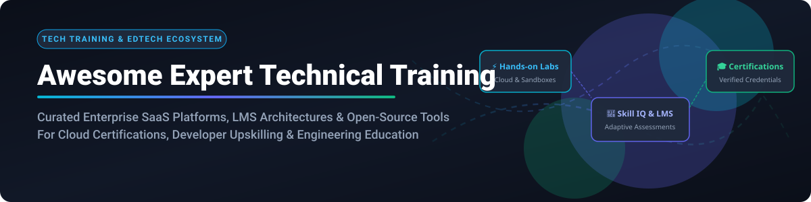
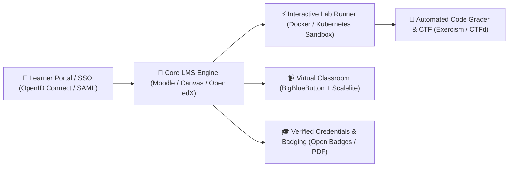

  

# 🎓 Awesome Expert Technical Training Ecosystem

    

> **A curated ecosystem of premier enterprise SaaS platforms, interactive cloud sandboxes, and production-grade open-source Learning Management Systems (LMS) for expert technical training, developer education, and IT certifications.** 🚀 Master cloud computing (AWS, Azure, GCP), cybersecurity, DevOps, AI/ML engineering, and enterprise software architectures.

**📅 Last updated:** October 2026

---

## 📌 Table of Contents

- [📈 Sector Overview & Market Dynamics](#-sector-overview--market-dynamics)
- [🏢 SaaS & Hosted Enterprise Training Platforms](#-saas--hosted-enterprise-training-platforms)
- [💻 Open-Source Technical Training & LMS Projects](#-open-source-technical-training--lms-projects)
- [💡 Custom Technical Training Architecture Framework](#-custom-technical-training-architecture-framework)
- [🤝 How to Contribute](#-how-to-contribute)
- [💖 Support & Sponsorship](#-support--sponsorship)
- [⚠️ Disclaimer](#%EF%B8%8F-disclaimer)
- [📈 Star History](#-star-history)

---

## 📈 Sector Overview & Market Dynamics

The global **Technical Training & IT Skill Development Market** is valued at approximately **$78.4 Billion in 2024–2025** and is projected to surpass **$142+ Billion by 2033** (expanding at a compound annual growth rate of ~7.1%), embedded within a broader enterprise corporate training expenditure exceeding **$380 Billion**. 🌐

The market structure is **moderately fragmented**: massive horizontal aggregators (Coursera, Udemy, LinkedIn Learning) and hyperscaler certification academies (Salesforce Trailhead, AWS Skill Builder, Microsoft Learn) command dominant brand awareness for generalized curricula, while deep technical mastery (hands-on cloud sandboxes, real-world cyber ranges, interactive code compilers, and bespoke enterprise apprenticeships) remains fragmented across focused innovators. Meanwhile, an enduring, enterprise-grade open-source LMS landscape (Moodle, Canvas LMS, Open edX) forms the bedrock for self-hosted university curricula, defense simulators, and sovereign corporate academies. ⚡

---

## 🏢 SaaS & Hosted Enterprise Training Platforms

Below is a curated comparison of leading SaaS technical training platforms, sorted by **company scale (Annual Revenue / Valuation, Descending)**. 💰

| SaaS Platform | Scale (Est. Revenue / Valuation) 📏 | Pricing Tier (Starting Rate) 💵 | Free Tier & Trial Limits ⏳ | Key Features & Core Focus 🎯 |
| :--- | :--- | :--- | :--- | :--- |
| **[Salesforce Trailhead Academy](https://trailhead.salesforce.com/)** | **~$34.9B Revenue** ($280B+ Market Cap) 🏢 | Free self-study; Instructor-led classes start at **$900 / class**; Certifications start at **$200 / exam attempt** 💰 | **Free forever tier**: Unlimited access to 1,000+ Trailhead modules, guided projects, and free Salesforce Developer Edition org sandboxes ⏳ | 🏆 Role-based Salesforce credentials, gamified Superbadges, hands-on dev org validation, and official certification paths. |
| **[LinkedIn Learning](https://learning.linkedin.com/)** | **~$16.0B Revenue** (Microsoft Owned, $3T+ Cap) 🏢 | Individual plan starts at **$39.99 / month** ($239.88 / year billed annually at $19.99/mo); Team plan starts at **$379.99 / license / year** 💰 | **1-month free trial** (30 days) with full access to 20,000+ courses, exercise files, and mobile offline viewing; free perpetual access via select partner public libraries ⏳ | 💼 Professional certifications, role-based career paths, verified LinkedIn profile credential badges, and Q&A forums. |
| **[Pluralsight Skills](https://www.pluralsight.com/)** | **~$3.5B Valuation** (Acquired by Vista Equity) 🏢 | Standard plan starts at **$29 / month** ($299 / year); Premium plan at **$449 / year**; Starter Team plan starts at **$399 / user / year** 💰 | **10-day free trial** (or up to 200 minutes of video) with access to core catalog; free permanent account includes 5 weekly rotating courses ⏳ | 🧠 Skill IQ benchmarking, Iris AI assistant, hands-on coding challenges, and role-based paths across cloud and cybersecurity. |
| **[A Cloud Guru](https://acloudguru.com/)** | **~$2.0B Valuation** (Pluralsight Group) 🏢 | Basic individual plan starts at **$35 / month** ($348 / year billed annually); Business plan starts at **$492 / user / year** (min 2 seats) 💰 | **7-day free trial** with access to live cloud sandbox environments, hands-on AWS/Azure/GCP lab exercises, and certification practice exams ⏳ | ☁️ Cloud certification prep for AWS, Azure, GCP, Linux, and Kubernetes with temporary cloud sandbox accounts and lab challenges. |
| **[Udemy Business](https://business.udemy.com/)** | **~$780M Revenue** ($1.1B Market Cap) 🏢 | Personal Plan starts at **$30 / month** ($240 / year billed annually); Team plan starts at **$360 / user / year** (min 5 users, $1,800/yr) 💰 | **7-day free trial** for Personal and Team plans with unrestricted catalog access; 500+ free introductory video courses accessible forever without certificate ⏳ | 🎯 25,000+ curated technical and leadership courses, analytics dashboard, coding exercise workspaces, and practice exams. |
| **[Coursera Enterprise](https://www.coursera.org/)** | **~$695M Revenue** ($1.2B Market Cap) 🏢 | Coursera Plus starts at **$59 / month** ($399 / year); Coursera for Teams starts at **$399 / user / year** (5–125 seats) 💰 | **Free forever audit mode** on 3,000+ courses (access video lectures and readings); **7-day free trial** for Coursera Plus subscription ⏳ | 🎓 University-backed Professional Certificates (Google, IBM, Meta), guided projects in browser-based VMs, and enterprise skill telemetry. |
| **[edX for Business](https://business.edx.org/)** | **~$700M Scale** (2U / Axim Collaborative) 🏢 | Verified certificate track starts at **$50–$300 / course**; Enterprise starts at **$349 / learner / year** (min 10 learners) 💰 | **Free forever audit track** for individual open courses (full access to video lectures and course materials during run time; no certificate) ⏳ | 🏛️ MicroMasters and Executive Certificates from MIT, Harvard, Oxford, and Berkeley; cutting-edge computer science & AI curriculum. |
| **[Skillsoft / Global Knowledge](https://www.globalknowledge.com/)** | **~$550M Revenue** (NYSE: SKIL) 🏢 | Skillsoft Percipio starts at **$19 / month** ($199 / year); Instructor-led live IT bootcamps start at **$1,795 / course** 💰 | **14-day free trial** of Percipio platform with access to tech & dev learning channels, coding sandboxes, and practice tests ⏳ | 🖥️ Enterprise IT certification bootcamps (Cisco, CompTIA, AWS, ITIL, VMware), authorized vendor courseware, and Percipio AI learning paths. |
| **[Codecademy](https://www.codecademy.com/)** | **~$525M Valuation** (Skillsoft Subsidiary) 🏢 | Pro plan starts at **$17.49 / month** ($209.88 / year billed annually); Teams starts at **$299 / user / year** 💰 | **Free forever Basic tier** with 180+ interactive coding lessons and syntax cheat sheets; **7-day free trial** for Pro tier ⏳ | 💻 Interactive in-browser IDE with immediate syntax feedback, portfolio projects, and structured career paths in web dev and data engineering. |
| **[QA Ltd](https://www.qa.com/)** | **~$390M Revenue** (£300M, CVC Capital) 🏢 | Digital platform subscription starts at **£29 (~$38) / month**; Live instructor-led courses start at **£750 (~$980) / course** 💰 | **7-day free trial** of digital learning platform for business teams on request; free attendance for open community webinars and tech intro days ⏳ | 🇬🇧 Leading UK tech skills and apprenticeship provider, accredited vendor bootcamps, cybersecurity masterclasses, and cloud architecture labs. |
| **[DataCamp](https://datacamp.com/)** | **~$120M Revenue** ($1B Valuation) 🏢 | Premium individual starts at **$12.50 / month** ($150 / year billed annually); Teams starts at **$25 / user / month** ($300/yr) 💰 | **Free forever tier** with access to the first chapter of all 400+ courses, 3 daily practice exercises, and in-browser code editor ⏳ | 📊 In-browser interactive data science & AI workspaces (Python, R, SQL, Power BI, Docker), automated grading, and real-world project portfolios. |
| **[Cloud Academy](https://cloudacademy.com/)** | **~$35M Revenue** (QA Subsidiary) 🏢 | Individual subscription starts at **$39 / month** ($348 / year billed annually); Small Teams plan starts at **$55 / user / month** 💰 | **7-day free trial** with access to live cloud environments, challenge labs, and certification assessment modules ⏳ | ⚡ Hands-on cloud sandboxes running in live AWS/Azure/GCP accounts, custom enterprise training plan builder, and team skill profiling. |

---

## 💻 Open-Source Technical Training & LMS Projects

Explore top-tier production-grade open-source learning management systems, interactive coding curriculums, cybersecurity testbeds, and technical training platforms. **Sorted by GitHub_Stars (Descending)**. ⭐

- **[freeCodeCamp](https://github.com/freeCodeCamp/freeCodeCamp)**   
  🌐 **The World's Most Popular Open-Source Technical Curriculum & Certification Platform**. Complete hands-on coding curriculum covering Full Stack Web Development, Python, Machine Learning, Data Analysis, and Cybersecurity with free verified certifications. *450,000+ stars on GitHub.* 🏆 (BSD-3-Clause)

- **[Developer Roadmap](https://github.com/kamranahmedse/developer-roadmap)**   
  🗺️ **Interactive Community Educational Roadmaps & Career Guides**. Comprehensive visual learning pathways for Frontend, Backend, DevOps, AI/Data Engineering, Cybersecurity, and Cloud Architects with curated resources and skill assessments. 🚀 (CC BY-NC-SA 4.0)

- **[DevOps Exercises](https://github.com/bregman-arie/devops-exercises)**   
  🛠️ **Technical Interview & Hands-on Engineering Exercises for DevOps & Cloud**. 2,600+ questions, code challenges, and architecture exercises spanning Linux, Bash, Python, AWS, Docker, Kubernetes, CI/CD, Terraform, and Prometheus. ⚙️ (Open Source)

- **[OWASP Juice Shop](https://github.com/juice-shop/juice-shop)**   
  🧃 **Premier Open-Source Insecure Web App for Hands-on Security Training**. The most modern and sophisticated insecure web application, covering the entire OWASP Top 10 along with various other security vulnerabilities for developer secure-coding exercises and CTF challenges. 🛡️ (MIT License)

- **[The Odin Project Curriculum](https://github.com/TheOdinProject/curriculum)**   
  📖 **Free Full-Stack Web Development Curriculum**. Open-source, project-driven software engineering pathway taking learners from terminal basics to full-stack JavaScript, React, Node.js, and Ruby on Rails. 💻 (CC BY-NC-SA 4.0)

- **[BigBlueButton](https://github.com/bigbluebutton/bigbluebutton)**   
  📹 **Open-Source Virtual Classroom Designed for Online Learning & Live Lectures**. Real-time sharing of audio, video, slides, chat, screen, multi-user whiteboard, breakout rooms, and LMS integration (LTI). 🧑‍🏫 (LGPL-3.0)

- **[Open edX](https://github.com/openedx/edx-platform)**   
  🎓 **Scalable Open-Source MOOC & Enterprise Learning Engine**. Deployed by universities and global organizations reaching 200M+ learners. Features course authoring (Studio), gradebooks, discussion forums, proctored exams, certificate generation, and modular XBlock architecture. 🏛️ (AGPL-3.0)

- **[Exercism](https://github.com/exercism/exercism)**   
  🧩 **Crowdsourced Code Mentoring & Fluency Platform**. Practice coding in 70+ programming languages with automated test suites, CLI test runner, syllabus tracks, and human-in-the-loop mentor feedback. 💡 (MPL-2.0)

- **[Moodle](https://github.com/moodle/moodle)**   
  🏫 **The World's Most Deployed Open-Source Learning Management System**. Powering 100,000+ learning institutions with 3,000+ plugins. Features blended learning, competency frameworks, automated certificate delivery, quizzes, SCORM compliance, and corporate multi-tenancy. 🌍 (GPL-3.0)

- **[CTFd](https://github.com/CTFd/CTFd)**   
  🚩 **Flagship Open-Source Capture The Flag (CTF) Cyber Training Framework**. Leading cyber competition and security training software used by DEF CON, universities, and enterprise red/blue teams for hands-on skill verification. 🎯 (Apache-2.0)

- **[Canvas LMS](https://github.com/instructure/canvas-lms)**   
  🎨 **Modern Open-Source LMS for Higher Education & Enterprise Training**. Features SpeedGrader, learning mastery gradebooks, Canvas Studio, and rich REST & GraphQL APIs with deep LTI 1.3 tool interoperability. 📐 (AGPL-3.0)

- **[Oppia](https://github.com/oppia/oppia)**   
  🤖 **Open-Source Interactive Learning & Tutoring Platform**. Simulates one-on-one personalized tutoring by providing targeted feedback based on learner inputs and automated misconceptions analysis. 📱 (Apache-2.0)

- **[Jupyter Book](https://github.com/jupyter-book/jupyter-book)**   
  📚 **Build Interactive Technical Textbooks & Computational Courseware**. Generates publication-quality HTML/PDF training materials from computational Jupyter Notebooks and Markdown with executable code cells. 🔬 (BSD-3-Clause)

- **[Kolibri](https://github.com/learningequality/kolibri)**   
  📶 **Offline-First Learning Platform for Low-Connectivity Environments**. Designed to deliver digital educational content and exercise tracking on low-resource hardware without internet access. 📦 (MIT License)

- **[Chamilo LMS](https://github.com/chamilo/chamilo-lms)**   
  ⚡ **Lightweight & High-Performance Open-Source LMS**. Deployed across 30,000+ organizations for intuitive course management, fast skill evaluation, timed assessments, and automated certificate generation. 🚀 (GPL-3.0)

- **[Scalelite](https://github.com/blindsidenetworks/scalelite)**   
  ⚖️ **Open-Source Load Balancer for BigBlueButton Clusters**. Distributes live virtual classrooms across multiple video conferencing servers for high-availability enterprise and university lecture scaling. 📡 (LGPL-3.0)

- **[ILIAS](https://github.com/ILIAS-eLearning/ILIAS)**   
  🛡️ **Flexible & Enterprise-Grade Open-Source LMS**. Established German open-source platform widely adopted by defense, healthcare, and higher education for structured curricula, learning communities, and digital assessments. 🔒 (GPL-3.0)

- **[OpenOLAT](https://github.com/OpenOLAT/OpenOLAT)**   
  ☕ **Java-Based High-Concurrency LMS**. Tailored for universities, banking institutes, and public institutions demanding robust compliance, fine-grained access rights, and mobile-responsive technical training. 💼 (Apache-2.0)

---

## 💡 Custom Technical Training Architecture Framework

When building a sovereign, self-hosted, or hybrid enterprise technical training ecosystem:

1. **LMS Orchestration Core**: Deploy **Moodle** or **Canvas LMS** for multi-tenant course management, SCORM compliance, and role-based gradebooks.
2. **Interactive Cloud & Code Sandboxes**: Integrate disposable container environments via Docker and Kubernetes alongside **Exercism** or **CTFd** for real-time execution and vulnerability verification.
3. **Live Virtual Instruction**: Leverage **BigBlueButton** paired with **Scalelite** load balancing for high-concurrency interactive workshops, breakout groups, and synchronized presentations.
4. **Computational Textbooks & Documentation**: Compile interactive reference materials with **Jupyter Book** for hands-on data science and software engineering walkthroughs.
5. **Credentialing & Verification**: Issue tamper-evident credentials utilizing open standard Open Badges v2/v3 frameworks.

---

## 🤝 How to Contribute

Contributions are warmly welcomed! Help us expand this ecosystem with leading technical training platforms, labs, and tools:

1. **Fork** this repository.
2. Add your SaaS product or open-source tool to `README.md` following the established table or badge structure.
3. Provide accurate company scale, explicit starting pricing, precise free tier limits, and official URLs.
4. Submit a **Pull Request** with a concise description of your changes.

---

## 💖 Support & Sponsorship

If you find **Awesome Expert Technical Training** valuable for your engineering team, educational institution, or career development, please consider supporting its ongoing curation! 🌟

- ⭐ **Star this repository** at the top right of the page to boost discoverability.
- 🔀 **Fork & Share** with your developer community, DevOps peers, and L&D managers.
- ☕ **Sponsor / Buy me a coffee**: Support open-source educational curation directly via the [GitHub Sponsor Dashboard](https://github.com/sponsors/ishandutta2007).

---

## ⚠️ Disclaimer

- This repository is a **community-curated index** intended for informational and educational purposes. It does not constitute commercial endorsement or financial advice.
- Technical training platforms handling learner assessments and corporate data must comply with international privacy standards (GDPR, CCPA, FERPA, SOC 2).
- Deploying self-hosted open-source LMS software and interactive code runners requires rigorous container sandboxing, resource isolation, and ongoing security updates to prevent arbitrary code execution vulnerabilities.

---

## 📈 Star History

---

  <b>Built for Software Engineers, Cloud Architects, L&D Leaders, and Technical Educators. 🌟</b> 
  <i>Empowering open, data-driven, and hands-on technical education worldwide.</i>

